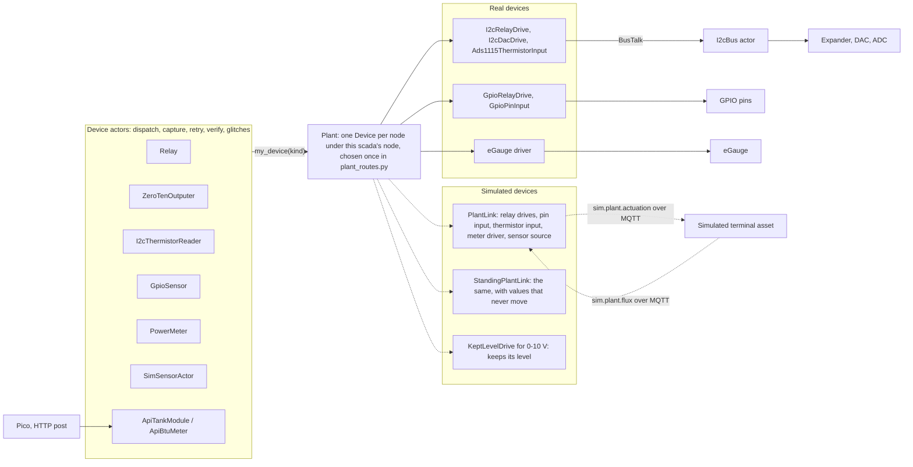

# Plant: how a device actor reaches its hardware

Status: Accepted · Pass 0 · Updated 2026-11-18

> What this is: the seam between a device actor and the thing it drives
> or reads. One router, the plant, stands behind every device node; a real
> board or a link to a simulated plant answers, and the actor cannot tell
> which. This is also the scada's side of the plant contract with a
> simulated terminal asset. Code: `gw_spaceheat/plant.py`,
> `plant_routes.py`, `plant_link.py`, `relay_drives.py`, `dac_drives.py`,
> `thermistor_inputs.py`, `pin_inputs.py`, `bus_talk.py`,
> `standing_plant.py`.

## The seam

A device actor asks for its device once, when it is built, by its own
node name and the kind of device it drives
(`actors/sh_node_actor.py` `my_device`). It says to that device only what
its channels, positions and levels are. No address, register, pin or chip
protocol is in an actor: that is resolved from the layout's board record
and lives in the device. Dispatch, capture policy, retry, confirmation,
verify passes and every glitch stay in the actor.

Solid lines are real hardware, dashed lines simulation. A real pico posts
to its actor over HTTP and has no device in the plant; only a tank module
or BTU meter on a `sim.pico.*` component word gets the link. The pico
actors' HTTP half is untouched by the seam.

## The device contract

- **Nothing a device is asked to do raises.** What its hardware throws
  comes back as a reason: text or nothing from a relay set, a saying
  (summary, details, streak) from a read or a prepare. The actor catches
  nothing and reports every reason it is handed as a glitch.
- **A streak reports once.** A fault that every call repeats is said as a
  streak and the actor reports it once, until a call for the same channel
  stops saying it. Anything a channel says that its previous call did not
  say is reported, so two faults alternating on one channel report on each
  flip. The actor keeps one streak set per channel (`plant.py` `Streaks`).
- **A device node without its device fails the boot.** An actor that asks
  for a node nothing was routed for, or for a kind the node's device is
  not, raises at construction and the process does not come up. A board
  device's place on its board is resolved from the board record whether
  or not the board is simulated, so a layout that misplaces a device
  fails the boot either way.
- **A device that reaches its hardware through another actor sends as
  its own actor's node.** The I2C devices talk to the bus actor through
  one conversation (`bus_talk.py`); the bus actor's reply comes back to
  the device's actor, which hands it down to the device (`hears`). A
  reply the device does not know is the actor's own unexpected payload.
- **A device says where it is** (`GPIO 22`, `plant relay vdc-relay`) and
  the actor's log lines use that; the actor does not know its pin.

## Routing

Routing happens once, where the app is built, before any actor exists
(`plant_routes.py` `route_devices`). Each scada process routes the device
nodes under its own scada node and no others: the primary routes the
nodes whose parent is `s`, the secondary those under `s2`. This is the
proactor's own rule for which nodes a process builds actors for. A node
another process runs is left to it, board data and all, so bad board data
on a node this process does not run cannot fail this process's boot.

Which device stands behind a node is decided by the node's actor class
and component:

| Actor class, component | Board not simulated | Board simulated or a sim word |
| --- | --- | --- |
| `Relay`, I2C relay component | `I2cRelayDrive` at the bit the board record names; reads back where the record says the board does | link relay drive, reading back where the board record says |
| `Relay`, GPIO relay component | `GpioRelayDrive` on the record's BCM pin; never reads back | link relay drive, no readback |
| `GpioSensor` | `GpioPinInput` on the record's BCM pin | link pin input on the node's one channel |
| `ZeroTenOutputer` | `I2cDacDrive` on the record's DAC | `KeptLevelDrive` |
| `I2cThermistorReader` | `Ads1115ThermistorInput` on the record's ADC | link thermistor input, one plant channel per thermistor and per microvolts channel |
| `PowerMeter`, eGauge | eGauge driver | plant-link meter driver (the sim power meter device type) |
| `SimSensorActor` | | the link itself, as a sensor source |
| `ApiTankModule`, `ApiBtuMeter` on a `sim.pico.*` component | no device: a real pico posts over HTTP | the link itself, as a sensor source |

A simulated node in a layout with no plant link fails the boot. An
electric meter of a device type with no driver fails the boot.

## The actors on the seam

**Relay.** Two paths. An I2C relay keeps its command as an enforcement
target: one attempt, a short backoff retry, then every verify pass until
the pin confirms. Where the drive reads back, a set is confirmed at the
pin, a disagreeing read is read again half a second later before it is
believed, and boot adopts the position the pins hold. Where the drive does
not read back, the actor believes what it last set and stays Unknown until
the first command. A GPIO relay has no readback and no retry: the set is
awaited in a task of its own, so its report leaves one loop turn after the
command, and a refused write is one Critical glitch and no report to the
boss. Confirming a set, retrying it and every glitch are the actor's; a
drive does one thing when asked and says how it went.

**GpioSensor.** Polls its pin and publishes on change and on its capture
period. Nothing is held while the pin cannot be read, so nothing is
published, and the next good value is published as a first reading
whatever the async-capture setting says.

**I2cThermistorReader.** Reads each thermistor through its input and
publishes temperature and microvolts. A read with no temperature clears
that channel's latest values. The layout needs exactly one I2C bus node
for a board reader to resolve; without it the boot fails.

**ZeroTenOutputer.** Prepares its output once after boot, retried each
heartbeat until ready (a bus refuses operations until its init guard
finishes), then re-asserts its target level each heartbeat and on each
dispatch, publishing the level held.

**PowerMeter.** Reads its meter on its own thread through the driver
the plant routed. A channel with no value inside `power_meter_lost_after_s`
flatlines.

**SimSensorActor** and the **sim pico actors** register their channels with the plant's sensor source at construction
and report each delivery as a synced reading at the plant's read time, to
the scada and to the derived generator where it consumes them. A sim pico
actor sends each delivery to the pico cycler as well, as a pico's post.

## Glitches on the device path

Every summary below is a `Glitch` with the actor's node as `Node`. A
streak glitch reports once per streak, per channel.

| Summary | Level | Actor | When |
| --- | --- | --- | --- |
| `relay-actuation-failed` | Critical | GPIO `Relay` | the drive refuses the write; no report to the boss, the machine holds the commanded state |
| `relay-report-failed` | Critical | GPIO `Relay` | the pin is set and building or sending the report raises; no report for that trigger |
| `i2c-relay-not-ready` | Critical | I2C `Relay` | a command arrives before boot adoption completes; the verify pass retries |
| `i2c-relay-actuation-failed` | Critical | I2C `Relay` | the set or its confirmation fails; held as enforcement target, retried after the backoff and on every verify pass; the drive is asked to check its expander |
| `i2c-relay-boot-adopt-failed` | Critical | I2C `Relay` | three pin reads at boot fail; state stays unreported until the first confirmed actuation |
| `i2c-relay-enforce-failed` | Critical | I2C `Relay` | a verify pass cannot re-assert the target, reported once per failing run |
| `i2c-relay-drift` | Warning | I2C `Relay` | the output register holds a position the machine's state does not expect; re-asserted |
| `gpio-read-failed` | Warning, streak | `GpioSensor` | the pin read raises, or the plant is silent |
| `i2c-thermistor-read-failed` | Warning, streak | `I2cThermistorReader` | the bus operation fails or times out, or the plant is silent |
| `i2c-thermistor-shorted` | Warning, streak | `I2cThermistorReader` | the input is at or under 0.01 V |
| `i2c-thermistor-broken` | Warning, streak | `I2cThermistorReader` | the input is at or over the reference voltage, or the implied temperature is at or under 0 °C |
| `i2c-thermistor-invalid-reading` | Warning, streak | `I2cThermistorReader` | the conversion raises; ends when the reading is valid again |
| `i2c-thermistor-publish-failed`, `i2c-thermistor-periodic-publish-failed`, `i2c-thermistor-reader-no-config` | Warning, once per process | `I2cThermistorReader` | the actor's own publishing fails, or the component has no channels |
| `i2c-dac-write-failed` | Warning, streak | `ZeroTenOutputer` | the level write fails |
| `i2c-dac-range-set-failed`, `i2c-dac-eeprom-read-failed`, `i2c-dac-eeprom-verify-failed` | Warning, streak | `ZeroTenOutputer` | the one step after boot fails: range set, EEPROM read, or EEPROM power-on level that cannot be made to match |
| `meter-start-warning` | Warning | `PowerMeter` | the driver warns at start |
| `meter-read-warning` | Warning, once per channel and warning kind | `PowerMeter` | a channel read warns; on a simulated meter, the plant is silent |

## On real hardware

A house whose layout has no simulated component builds no plant link and
no extra MQTT client. The I2C sequences are the board's: the expander's
read-modify-write, timeouts and retry backoff; DAC writes, EEPROM
power-on verify and reprogram; ADS1115 config readback and conversion;
the eGauge driver. The devices are set up when their actor is built: a
GPIO pin at construction, the eGauge driver at routing.

- A GPIO sensor whose pin read raises warns `gpio-read-failed` once per
  streak, holds and publishes nothing while it lasts, and publishes the
  first good value as a first reading.
- A GPIO relay whose pin write raises sends one Critical
  `relay-actuation-failed` and no report; nothing retries on this path.
- A GPIO relay's report leaves one loop turn after the command.
- The relay pin's in-use warning is dropped at its setup: a restart
  inherits a pin the previous process left driven, so the relay never
  drops across a restart, and the warning cannot tell that from another
  process holding the pin. Sensor pins keep their warning.
- A thermistor reader in a layout without exactly one I2C bus node fails
  the boot.
- `i2c-thermistor-invalid-reading` ends when the reading is valid again
  and can recur.
- A bus result of success with no value is a failed read.
- Log lines name the device's place (`Energize set on GPIO 23`); neither
  the DAC code nor the ADC address is logged.

## On a simulated layout

This is the scada's side of the plant contract. The other side is the
simulated terminal asset.

- **A plant is required.** `plant_link` in the scada settings is one of
  `Broker` (default), `InProcess` and `Standing`, and is read only when
  the layout has a simulated device. The actors invent no values: with no
  plant, every simulated sensor is silent, and a flux is all the plant
  shows, so a channel it leaves out has no value.
- **Two words cross, both staging** (`sim.plant.flux` in,
  `sim.plant.actuation` out), on an MQTT client of the plant link's own,
  so losing it is a sensor outage and nothing else. Channel names, relay
  node names, positions and times are all that cross. The broker link
  subscribes to the flux topic in the wrapped `gw` grammar from the
  plant's alias to the scada's, publishes actuations at QoS 0 and asks
  for no acknowledgement; a payload that is not a flux is logged and
  dropped. The link's client is built from the scada's upstream MQTT
  settings and ignores TLS (dev broker only). A setting of its own for
  this broker is simulated-world decision 5, open.
- **Silence.** A plant quiet for 15 s is gone. A polled read then fails:
  `gpio-read-failed`, `i2c-thermistor-read-failed` or `meter-read-warning`,
  once per streak. A plant never heard is given the same 15 s from the
  link's start, so a scada and a plant that boot together meet without a
  failed read. A told sensor simply stops reporting.
- **Relays.** A simulated relay's position goes to the plant on each
  command and each verify pass; a set always takes, since nothing comes
  back. Every held position is restated on each MQTT connect and when a
  silent plant is heard again, which is how a lost actuation heals. It
  reads back where its board record says the board does: what the plant
  was last told, and de-energized before the plant was told anything, as
  a board powers on. A link that raises is `i2c-relay-actuation-failed`
  with its backoff. No simulated relay touches the bus.
- **0-10 V output.** Holds whatever level it is set. Nothing crosses to
  the plant; the plant learns what the pumps do from the relays. (A way
  for the actuation word to say a level is a sema gap.)
- **Tank modules and BTU meters.** Each flux that has one of their
  channels is taken as a pico's post, stamped with the plant's read time,
  so they report at the flux rate. Values arrive in the channel's own
  encoding: the thermistor maths, the open-thermistor guard and the BTU
  implausible-temperature guard are not on this path. A sim pico whose
  channels the plant stops showing is missing after 2.5 capture periods,
  and the pico cycler power-cycles for it; the scada plays no pico death
  of its own.
- **Power meter.** The hardware uid is the layout's own.
- **The bus actor** runs on a simulated board, idle.
- **The standing plant** (`Standing`) is a plant inside the scada for
  running a simulated layout alone: every sensed channel holds one value
  for ever and no relay moves any of them. The one thing a relay changes
  is pico power, so the pico cycler has something to recover. `InProcess`
  is the test as the plant: it shows values and records actuations.

## Processes

The primary scada builds the plant link, routes the nodes under `s`, and
starts the link's connection with its own tasks and stops it with them,
so an instantiated-but-never-run scada opens no connection. The secondary
builds no link and routes the nodes under `s2`; a simulated device under
`s2` fails the secondary's boot for want of a link. A GPIO sensor under
`s2` works. A relay or board reader under `s2` does not: every I2C device
talks to the one bus node, which sits under `s`; a relay's bosses all run
in the primary; the command path across processes has no design yet.

## Open

- A thermistor channel the flux leaves out is silent: no temperature,
  nothing published, no glitch. The other simulated readers warn or
  flatline.
- No test covers the thermistor reader's boot failure on a layout
  without exactly one bus node.
- `GpioRelayDrive` has a setup test and no write test; it writes a pin
  only on a Pi.
- The real eGauge path has no test.
- `plant.md` reaches Verified on a simulated house from this code
  running a day against a plant (OPS-692's EDD clause).
